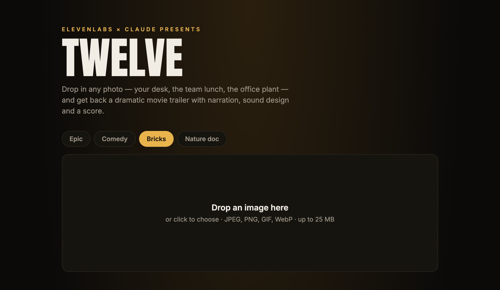
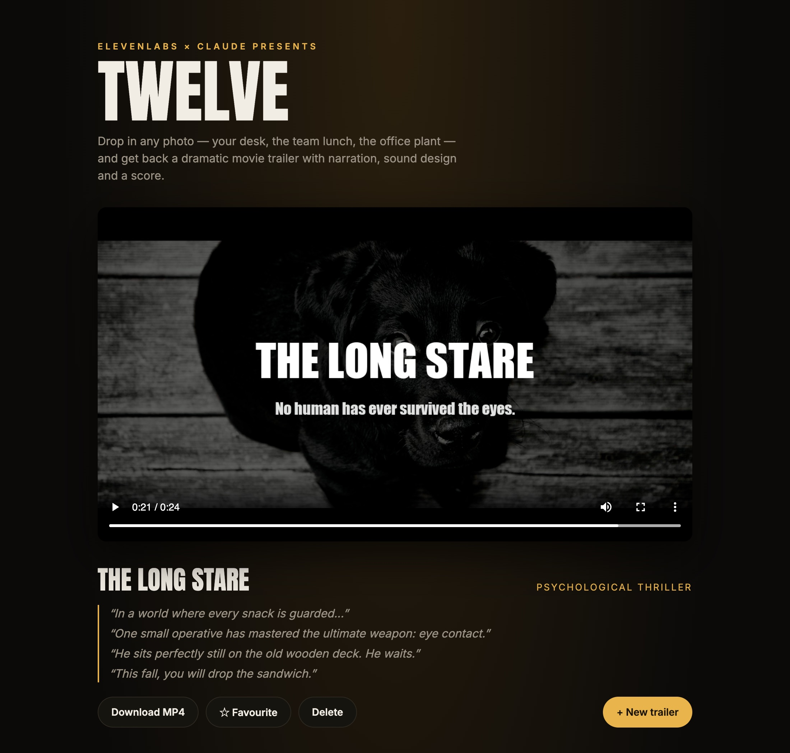
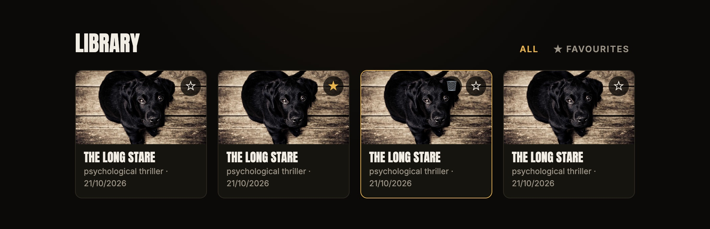

<p align="center">
  
</p>

<h1 align="center">Twelve</h1>

<p align="center">Drop in any photo and get back a dramatic movie trailer, with narration, sound effects and a score.<br/>Built with <a href="https://elevenlabs.io">ElevenLabs</a> and <a href="https://claude.com">Claude</a>.</p>

## Showcase

One photo of a puppy in, *The Long Stare* out:

<p align="center">
  
</p>

> *"In a world where every snack is guarded…"*<br/>
> *"One small operative has mastered the ultimate weapon: eye contact."*<br/>
> *"He sits perfectly still on the old wooden deck. He waits."*<br/>
> *"This fall, you will drop the sandwich."*

▶️ [**Watch it with sound**](docs/showcase.mp4?raw=true) (the GIF above is silent)

<sub>Photo by André Spieker on <a href="https://unsplash.com/photos/8wTPqxlnKM4">Unsplash</a>.</sub>

## The app

Pick a style and drop in a photo:



The finished trailer takes over the stage, with its script, a download link and a button to start the next one:



Every trailer you make is kept in the library below. Star the ones worth keeping, filter down to your favourites, or delete the rest for good:



## Styles

Pick one in the web UI, or pass `--style` on the command line. Each style changes the script, the sound palette, the narrator's delivery and the look.

| Style | What you get |
|---|---|
| `epic` (default) | Brooding blockbuster: "In a world...", booms and risers, film grain, flicker and shake |
| `comedy` | Goofy family comedy: punchline cards, boings and record scratches, bright and saturated |
| `bricks` | Toy-brick adventure: everything is awesome, plastic clicks and tiny footsteps, heroic toy orchestra, bright colours |
| `nature` | Hushed wildlife documentary: whispered observations, birdsong, sweeping strings |

Every style except Epic has its own narrator, designed from a written description the first time you use it. The voice is saved to your ElevenLabs account, and its ID is kept in `out/voices.json`. The free plan has 3 custom voice slots, exactly enough for these three; Epic uses the premade George voice.

Styles live in `src/styles.ts`, so adding one means writing a brief, a narrator description, voice settings and a look.

## How it works

1. **Claude** (Opus) looks at the image and writes the trailer: title, tagline, voiceover lines with delivery directions (`[whispers]`, `[laughs]`), a short scene between two characters from the photo (each cast with a fitting voice), a shot list (where the camera frames, how tight, which way it moves, plus the odd text card), timed sound-effect cues and a music brief. It uses the Claude API if `ANTHROPIC_API_KEY` is set, otherwise your local [Claude Code](https://claude.com/claude-code) login (`claude -p`), so no API credits are needed.
2. **ElevenLabs** voices the narration with Eleven v3, which acts out the audio tags (Text to Speech), performs the character scene in one take (Text to Dialogue), and generates each sound effect plus a seamless 10s loop for the score (Sound Effects). Comedy, Bricks and Nature doc each get a narrator made with Voice Design the first time you use them. On a paid plan, set `ELEVENLABS_MUSIC=1` to compose a real score with the Music API.
3. **ffmpeg** (bundled via `ffmpeg-static`) ducks the effects and score under the narrator so every line stays clear, cuts one shot per narration line out of the photo (push-ins, pull-outs and pans on the details Claude picked), drops in black text cards, lands impact sounds on the cuts with a camera shake and white flash, applies the style's grade (film grain, flicker and a vignette for epic), mixes everything to -14 LUFS and ends on a title card. Pauses between lines stretch so every trailer runs 45 seconds.

## Setup

```bash
npm install
cp .env.example .env   # then add your ELEVENLABS_API_KEY
```

## Run

```bash
npm start                         # web UI at http://localhost:4712
npm run trailer -- path/to/photo.jpg   # or straight from the terminal
npm run trailer -- photo.jpg --style bricks
```

Output (the MP4 plus every intermediate clip and `plan.json`) lands in `out/`.

## Free plan budget

Built to fit the ElevenLabs free tier: at most 2 requests in flight (with retry on 429), up to 8 narration lines, a 4-line scene, 6 short sound effects and a looped score. A 45-second trailer costs roughly 600-900 of the 10,000 monthly credits, mostly voices. Designing a style's narrator is a one-off extra.

## Options (`.env`)

| Variable | Default | |
|---|---|---|
| `ELEVENLABS_VOICE_ID` | George, or the style's designed narrator | Narrator voice for every style, skipping Voice Design |
| `FONT_FILE` | Impact / Arial Bold / DejaVu Sans Bold | Bold `.ttf` for the title card |
| `ELEVENLABS_MUSIC` | off | `1` to use the Music API (paid plans) |
| `ELEVENLABS_CONCURRENCY` | `2` | Parallel ElevenLabs requests |
| `PORT` | `4712` | Web UI port |
