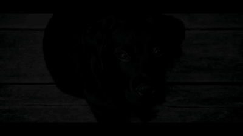
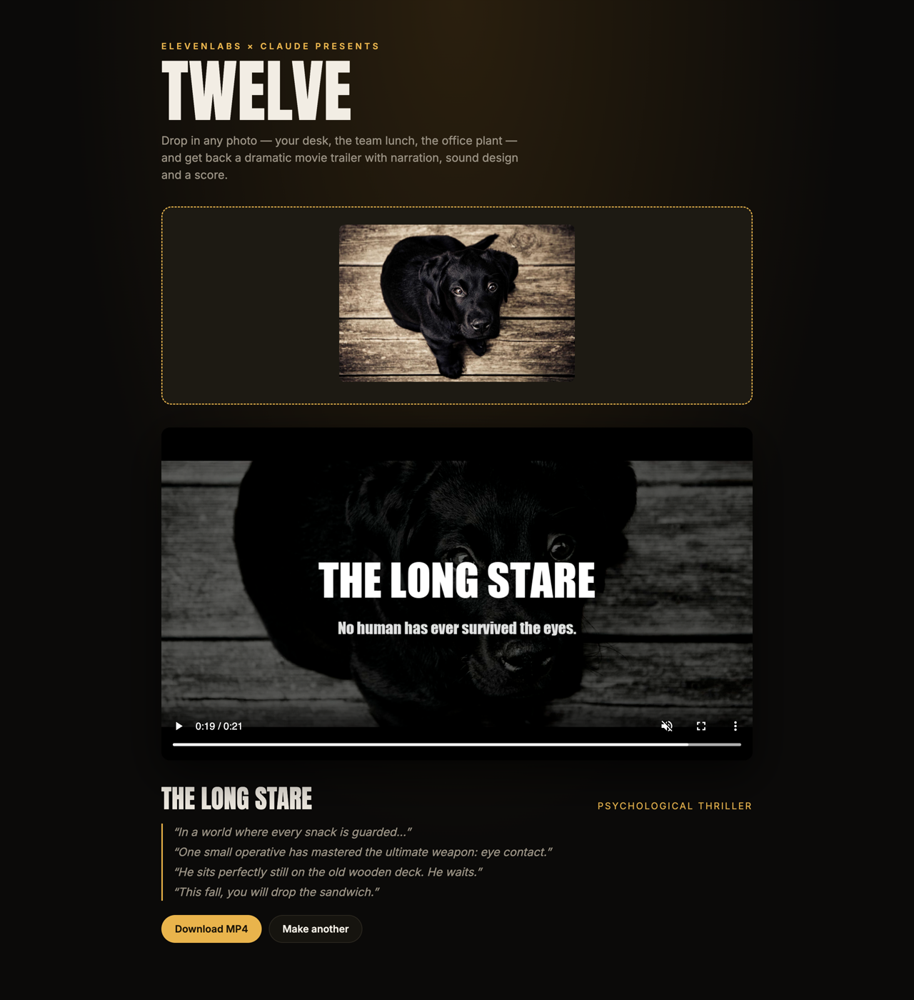

<p align="center">
  
</p>

<h1 align="center">Twelve</h1>

<p align="center">Drop in any photo and get back a dramatic movie trailer, with narration, sound effects and a score.<br/>Built with <a href="https://elevenlabs.io">ElevenLabs</a> and <a href="https://claude.com">Claude</a>.</p>

## Showcase

One photo of a puppy in, *The Long Stare* out:

<p align="center">
  
</p>

> *"In a world where every snack is guarded…"*<br/>
> *"One small operative has mastered the ultimate weapon: eye contact."*<br/>
> *"He sits perfectly still on the old wooden deck. He waits."*<br/>
> *"This fall, you will drop the sandwich."*

▶️ [**Watch it with sound**](docs/showcase.mp4?raw=true) (the GIF above is silent)

<sub>Photo by André Spieker on <a href="https://unsplash.com/photos/8wTPqxlnKM4">Unsplash</a>.</sub>

## The app



## How it works

1. **Claude** (Opus) looks at the image and writes the trailer: title, tagline, voiceover lines, a shot list (where the camera frames, how tight, which way it moves, plus the odd text card), timed sound-effect cues and a music brief. It uses the Claude API if `ANTHROPIC_API_KEY` is set, otherwise your local [Claude Code](https://claude.com/claude-code) login (`claude -p`), so no API credits are needed.
2. **ElevenLabs** voices the narration (Text to Speech) and generates each sound effect plus a seamless 10s loop for the score (Sound Effects). On a paid plan, set `ELEVENLABS_MUSIC=1` to compose a real score with the Music API.
3. **ffmpeg** (bundled via `ffmpeg-static`) cuts one shot per narration line out of the photo (push-ins, pull-outs and pans on the details Claude picked), drops in black text cards, lands impact sounds on the cuts with a camera shake and white flash, adds grain, flicker and a vignette, mixes everything to -14 LUFS and ends on a title card.

## Setup

```bash
npm install
cp .env.example .env   # then add your ELEVENLABS_API_KEY
```

## Run

```bash
npm start                         # web UI at http://localhost:3000
npm run trailer -- path/to/photo.jpg   # or straight from the terminal
```

Output (the MP4 plus every intermediate clip and `plan.json`) lands in `out/`.

## Free plan budget

Built to fit the ElevenLabs free tier: at most 2 requests in flight (with retry on 429), 4 short sound effects and a looped score. A trailer costs roughly 200-350 of the 10,000 monthly credits.

## Options (`.env`)

| Variable | Default | |
|---|---|---|
| `ELEVENLABS_VOICE_ID` | George | Narrator voice from the Voice Library |
| `FONT_FILE` | Impact / Arial Bold / DejaVu Sans Bold | Bold `.ttf` for the title card |
| `ELEVENLABS_MUSIC` | off | `1` to use the Music API (paid plans) |
| `ELEVENLABS_CONCURRENCY` | `2` | Parallel ElevenLabs requests |
| `PORT` | `3000` | Web UI port |
